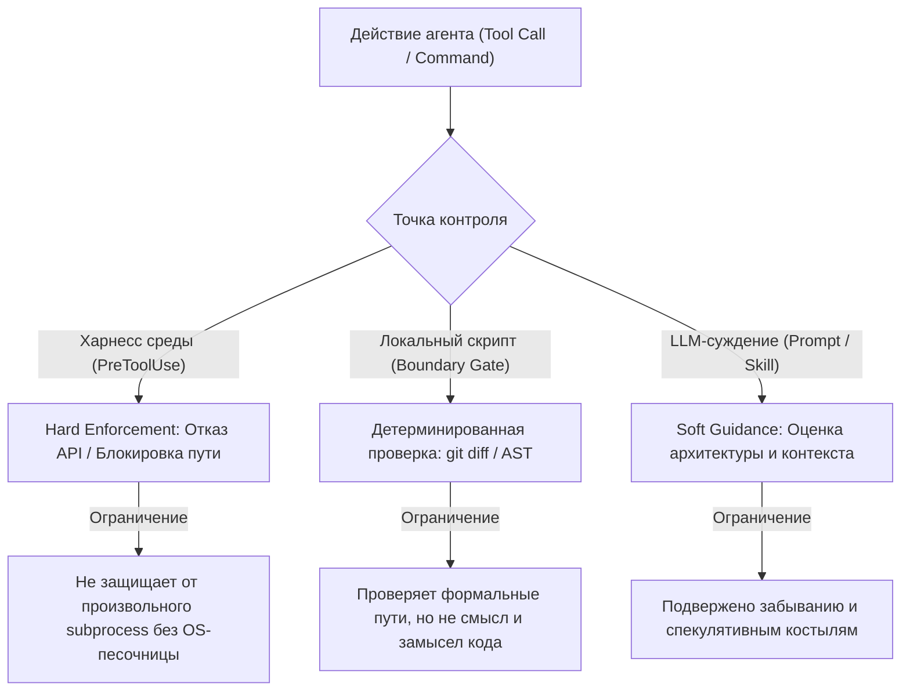

# Философия, архитектурное видение и принципы Meta-Project

Документ обобщает концептуальные основы, фундаментальные принципы и стратегическое видение развития фреймворка Meta-Project на базе результатов независимого архитектурного аудита (коммит `398a171`), локальной верификации кодовой базы и сравнительного анализа ландшафта инструментов агентной разработки.

---

## 1. Концепция, миссия и North Stars

### 1.1. Главная цель (North Star #0): Сохранение мета-видения (Meta-Vision Preservation)
Ключевая проблема длительного использования AI-агентов в кодовой базе — **смысловой дрейф (Semantic Drift)**.  
В процессе десятков и сотен микро-сессий агент аккуратно правит код, прогоняет локальные тесты и даже формально обновляет списки модулей, но постепенно и незаметно разрушает фундаментальные принципы системы (например, внедряет неявные сетевые зависимости в локальный инструмент, плодит дублирующие контракты или размывает ответственность модулей).

**Meta-Project** решает задачу поддержания актуальной модели проекта:
> **Замкнутый цикл контекстного менеджмента:**  
> `Модель проекта (Паспорт + Срезы знаний)` ➔ `Постановка задачи` ➔ `Контролируемое изменение (Boundary Gate)` ➔ `Оценка последствий (Verification)` ➔ `Актуализация модели (Opportunistic Refresh)` ➔ `Следующая задача`.

### 1.2. Фундаментальные инварианты фреймворка

1. **Zero-Dependency Core & Default Closed Tooling (Python 3.10+ stdlib & Git):**  
   Обязательное ядро (проверочные утилиты `scripts/`, генераторы, валидаторы и тесты целостности) по умолчанию функционирует в полностью закрытом автономном контуре, используя исключительно стандартную библиотеку Python и Git без `pip install`, Node.js или внешних бинарных зависимостей. Подключение сторонних инструментов допускается **исключительно при явном разрешении (opt-in) в спецификации проекта**; ответственность за возможные сбои стороннего тулинга возлагается на применяющую сторону.
2. **File-Native & Git-Centric:**  
   Знания хранятся в открытых, прозрачных файлах Markdown рядом с кодом, версионируются в Git, доступны для привычного `diff` и код-ревью человеком. Никаких закрытых бинарных баз данных, скрытых векторных индексов или фоновых демонов.
3. **Диета контекста (No Context Bloat):**  
   Корневой паспорт (`AGENTS.md`) содержит только фундаментальные ориентиры (North Stars), стек и протоколы навигации. Оперативные знания разделены на сфокусированные срезы (`.agents/project_knowledge/`) и подаются агенту строго по запросу (Just-In-Time).
4. **Машинный контроль вместо ритуалов (Code over Rituals):**  
   Любое правило, которое можно проверить алгоритмически, должно проверяться скриптом: *«LLM решает КОГДА, скрипт выполняет КАК»*. Декларативные подсказки в Markdown, не подкрепленные машинными гейтами, вырождаются в карго-культ.
5. **Неразрушающий жизненный цикл (Non-Destructive Lifecycle):**  
   Любые процедуры инициализации, аудита, обновления или ротации памяти сохраняют накопленные пользовательские факты (`observations.md`, проектные инварианты, ручные заметки) без деструктивной перезаписи.
6. **Принцип Default Deny (Black Zone):**  
   Любой путь или директория, явно не сопоставленная с Зеленой, Желтой или Красной зоной ответственности в `boundaries.md`, является строго запрещенной для автономной модификации агентом.

### 1.3. Правила самообновления знаний по типам (Knowledge Self-Update Rules)

Чтобы автоматическая актуализация знаний не размывала замысел проекта, вводятся четыре дифференцированных правила по типам данных:

1. **Факты о кодовой базе (Codebase Facts):** модули, пути, сигнатуры, версии, структура каталогов. Актуализируются автоматически и оппортунистически (*Opportunistic Refresh*) при обнаружении изменений в коде.
2. **Гипотезы и предположения (Hypotheses & Assumptions):** возможные причины сбоев, догадки об архитектуре, предположения о поведении среды. Обязаны явно маркироваться как гипотезы, проверяться эмпирически (замерами, тестами, выводом команд) и никогда не повышаться в статус фактов автоматически без подтверждения.
3. **Архитектурные решения (Architectural Decisions):** регулируются протоколом ADR и цепочкой Decision-RTL. Фиксируют проблему, контекст, затронутые инварианты, выбранный путь, компромиссы и фактический результат проверки. Решения о пересмотре целей, инвариантов и существенных архитектурных компромиссов принимает человек. Агент самостоятельно проверяет соответствие замыслу при планировании и самопроверке (self-verification), дописывает фактические результаты проверки и уточняет факты об уже принятом решении.
4. **Цели и фундаментальные инварианты (North Stars & Core Invariants):** назначение проекта, базовые архитектурные ограничения и границы допустимого. Являются прерогативой владельца проекта (человека). Агент проверяет соответствие этим ориентирам при планировании и верификации; автономным агентам запрещено самостоятельно отменять, ослаблять или произвольно пересматривать утверждённые цели системы.

---

## 2. Статус ядра: аудит и локальное развитие

### 2.1. Результаты внешнего аудита (коммит `398a171`)
Инструментальный прогон эталонного состояния репозитория на Python 3.12 подтвердил прохождение 51/51 теста без внешних библиотек и работоспособность ключевых компонентов:
- **Машинный контроль границ (`scripts/check_boundaries.py`):** разбор Markdown-глобов, распознавание исключений в скобках, приоритет точечных масок над широкими каталожными шаблонами, CLI-режимы `--staged`, `--diff`, `--audit-tree` и `--install-hook`.
- **Синхронизация канонических шаблонов (`scripts/sync_templates.py`):** предотвращение расхождения между `templates/` и встроенными копиями в `skills/` с контролем дрейфа (`--check`).
- **Scale-Adaptive Topology:** динамическое масштабирование команды под объем кодовой базы (от 1 агента для малых репо до триады и специализированных воркеров с диспетчером для монорепозиториев).
- **Экстренное заземление (`skills/ground-meta-project`):** принудительный зум-аут и остановка зацикленных правок при нарушении операционного коридора.

### 2.2. Локальная доработка и расширение верификации
- **Расширение тестовой матрицы:** добавлен 52-й регрессионный тест (обработка не-ASCII символов, пробелов и специальных символов в путях); подтверждено прохождение 52/52 тестов на Python 3.10–3.12.
- **Устранение уязвимости парсинга путей Git:** отказ от наивного снятия кавычек (`strip('"\'')`) и флага `core.quotepath=false`, которые ломались на именах с табуляцией, переводами строк, двойными кавычками и апострофами на конце. Переход на NUL-разделитель (`git ls-files -z` и `git diff --name-only -z`) с разделением по байту `\0` без искажения символов настоящего имени.
- **Единый источник правды по дефектам и дорожной карте:** детальные описания воспроизведённых дефектов ядра и единственный актуальный бэклог (P0, P1, P2, Icebox) вынесены в канонический документ [`docs/decisions_and_roadmap.md`](decisions_and_roadmap.md#7-стратегический-обзор-архитектуры-дефекты-ядра-и-актуализированный-бэклог-2026-11-12) для исключения дублирования.

---

## 3. Точки роста и архитектурные дилеммы

### 3.1. Soft Control vs Hard Enforcement
Декларативные правила в системном промпте («не трогай Red Zone», «обнови архитектуру») подвержены когнитивному спаду внимания моделей (туннельное зрение на коде).  
Однако механическое принуждение имеет строгие границы применимости:



1. **Разделение «Суждение — LLM, Запись — Скрипт»:**  
   Агент не должен вручную форматировать Markdown-таблицы в `observations.md` или высчитывать хэши. Необходима детерминированная утилита `scripts/record_obs.py` с автоматической валидацией категорий, экранированием пайпов `|`, дедупликацией и защитой от race conditions.
2. **Пределы возможностей файловых хуков среды:**  
   Хуки `PreToolUse` (в Claude Code, Cursor, Codex) способны перехватить вызовы `Edit` и `Write` по путям файлов. Однако они **не блокируют** скрипты на Python/Node.js, которые сами открывают и пишут файлы, если в среде не включена системная песочница (OS-level sandbox). Поэтому хуки рассматриваются как надёжный guardrail быстрого реагирования, а окончательным backstop выступает CI и Git pre-commit.
3. **Границы машинного гейта и распределение ответственности:**  
   Функция `classify_path()` и Boundary Gate проверяют формализованные синтаксические ограничения путей. Скрипт не обладает пониманием смысла кода и не может выявить концептуальное противоречие замыслу проекта (например, подключение внешнего облака вместо локальной обработки). Агент самостоятельно проверяет содержательное соответствие целям и North Stars на этапах декомпозиции, планирования и самопроверки; человек оценивает решения на код-ревью и утверждает изменения инвариантов и целей проекта.
4. **Принцип Default Closed Tooling и разграничение ответственности:**  
   По умолчанию Meta-Project гарантирует 100% автономную работоспособность «из коробки» без внешних зависимостей (`Python stdlib + Git CLI`). Сторонние проверенные утилиты (например, сканеры вроде Gitleaks, форматтеры `ruff`, специфические анализаторы) разрешены **только если в спецификации проекта явно указано разрешение на внешний тулинг** (`external_tools: [...]`). Если же объявлен закрытый изолированный контур (`air-gap`) или прямой запрет, любые проверки выполняются строго внутренними силами стандартной библиотеки. В случае явного разрешения внешних инструментов ответственность за их совместимость, окружение и поведение ложится на проект/оператора, а не на базовое ядро фреймворка.

### 3.2. Баланс ограничений и ложные стоп-краны
При проектировании автоматических блокировок выявлены антипаттерны, ухудшающие разработку:
- **Инвариант состязательного тестирования (Adversarial Testing Invariant):**  
  Анализ дефектов ранних версий показал, что тесты, написанные исключительно под «счастливый путь» (happy path), создают ложное ощущение безопасности. В процессе TDD агент **обязан включить минимум один негативный / граничный тест** (некорректный ввод, пустые данные, спецсимволы, отсутствие сентинелов, отказ целевого ресурса) до перехода к фазе реализации (Green).
- **Разделение прав на чтение и запись в Красной зоне:**  
  Красная зона строго запрещает *модификацию* файлов без подтверждения пользователя. Однако **Red Zone сама по себе не запрещает чтение; разрешения на чтение определяются отдельной политикой доступа** (например, доступ к секретам, учетным данным и приватным ключам ограничивается независимо от цветовых зон). Запрет на чтение кодовых контрактов или тестов целостности ослепляет агента и провоцирует галлюцинации.
- **Отказ от числовых счетчиков правок (Circuit Breaker):**  
  Идея блокировать агента по факту N-й модификации одного файла (как на 3-й, так и на 2-й правке) ошибочна: количество записей файла само по себе ничего не доказывает. Нормальный цикл TDD и отладки регулярно требует серии правок (добавление логов, фикс опечатки, откат экспериментального кода). Числовой лимит провоцирует агента делать один нечитаемый «мега-патч».  
  Смысловой стоп-кран формулируется иначе: **повторные неудачные попытки устранить один дефект или возникновение новых смежных регрессий требуют немедленной остановки, пересмотра гипотезы, принудительного зум-аута и сквозной трассировки жизненного цикла данных**.
- **Разделение события Stop и чек-листа Definition of Done:**  
  Событие харнесса `Stop` срабатывает на *каждый* ответ ассистента в диалоге (включая промежуточные уточняющие вопросы). Блокировать событие `Stop` требованием «не тронут architecture.md» разрушает интерактивное общение. Жесткий чек-лист DoD должен привязываться к явному действию сдачи задачи (`verify-task`, `pre-commit`, PR), а не к любому ответу в чате.

### 3.3. Архитектура интеграции с хуками: единое ядро
Вместо разделения на разные репозитории принимается архитектура **«Единое stdlib-ядро + адаптеры сред»**:
- Логика проверки зон и политик сосредоточена в `scripts/check_boundaries.py`.
- Каталог `hooks/` содержит тонкие адаптеры под спецификации харнессов:
  - Claude Code / Cursor: `.claude/settings.json` (PreToolUse на `Edit`/`Write`, SessionStart).
  - Codex: `.codex/hooks.json`.
  - Gemini CLI: `.gemini/settings.json` (`BeforeTool`).
  - GitHub Copilot CLI: `.github/hooks/*.json`.
- Утилита `hooks/install.py` управляет тремя операциями: `install` (аккуратное объединение с существующим конфигом), `verify` (проверка ответа хука) и `uninstall` (чистый откат без потери настроек).

### 3.4. Топология Tier 0 (Micro-Mini Duo)
Для компактных репозиториев (<3–5k LOC), где разворачивание триады ролей (`dev-lead`, `quality-guardian`, `github-steward`) создаёт избыточное трение и усталость от эстафет, вводится минимальный защитный дуэт:
- **`Worker / Dev`:** выполняет непосредственную инженерную работу (TDD с негативными тестами, реализация, обновление задач).
- **`Inspector / Guardian` (объединённая роль):** совмещает независимую приёмку качества (запуск полного сьюта тестов, проверка 0 drift, аудит покрытия границ) и фиксацию изменений в Git (проверка рабочего дерева, оформление conventional commit).
*Принцип:* даже в микро-проектах **недопустим полностью неконтролируемый моно-агент**. Внешний независимый контроль качества и чистоты коммита сохраняется всегда, но сжимается до одной контрольной передачи: `Dev ➔ Inspector/Guardian`.

---

## 4. Сравнительный обзор возможностей и рыночная ниша

Качественный сравнительный обзор подходов открытых проектов к управлению контекстом агентов (по состоянию на ноябрь 2026 года):

| Проект | Архитектурный фокус | Формат хранения | Особенности реализации | В чём отличие Meta-Project |
|---|---|---|---|---|
| **[Cline Memory Bank](https://github.com/cline/cline)** | Структурированная память проекта в каталоге `memory-bank/` (`activeContext`, `progress`, `systemPatterns`), инструкции и правила в `.clinerules/`. | Markdown в `memory-bank/` | Обновление файлов памяти координируется системными промптами агента; управление размером контекста возлагается на дисциплину диалога. | Дополняет структурированную память детерминированным машинным гейтом (`check_boundaries.py`), политикой Default Deny, тегами `[pin]` и алгоритмической компакцией. |
| **[Agent OS](https://buildermethods.com/agent-os)** | Извлечение стандартов из legacy-кода, генерация спецификаций и инъекция правил на базе методологии shaping/specs. | Markdown в `agent-os/` | Ориентирован на процесс разработки через формализованные спецификации (shaping/specs). | Предоставляет модульный защитный каркас и машинные границы, применимые к любому стилю разработки без обязательной привязки к спекам. |
| **[Superpowers](https://github.com/obra/superpowers)** | Процедурные навыки разработки: TDD, Systematic Debugging, Planning, Subagents. | SKILL.md и плагины | Сфокусирован на поведении агента в диалоге и дисциплине исполнения кода (TDD, систематическая отладка, декомпозиция). | Комплементарный симбиоз: Superpowers задает подход к разработке («как кодить»), Meta-Project — границы и память («где и в каких рамках»). |
| **[BMAD Method](https://github.com/bmad-code-org/BMAD-METHOD)** | Адаптивная ролевая agile-команда для агентов, планирование спринтов, фазовые артефакты. | Markdown + npm-пакет | Опирается на экосистему Node.js/npm для оркестрации ролевых фаз разработки. | Zero-dependency ядро на чистом Python stdlib + Git; адаптивная топология (вплоть до работы без команды); детерминированные машинные гейты. |
| **[GitHub Spec Kit](https://github.com/github/spec-kit)** | Конституция репозитория, спецификации изменений (SDD), workflows и пресеты. | `.specify/` + CLI | Сосредоточен на жизненном цикле отдельных продуктовых фич (Spec -> Plan -> Tasks). | Фокусируется на долговременных архитектурных инвариантах всей кодовой базы, зонах риска и предотвращении смыслового дрейфа. |
| **[OpenSpec](https://github.com/Fission-AI/OpenSpec)** | Спецификации изменений, дельта-планирование и архив завершенных задач. | Markdown в `openspec/` | Специализируется на структурировании задач и дельта-планировании изменений. | Фокусируется на защите архитектурных инвариантов, матрице зон ответственности и поддержании переносимого паспорта репозитория. |
| **[Rulesync](https://github.com/dyoshikawa/rulesync)** | Синхронизация правил, хуков, permissions и MCP между 40+ агентными средами. | Центральный конфиг + генераторы | Сфокусирован на трансляции и конвертации форматов конфигурации между сторонними средами. | Meta-Project управляет внутренней архитектурной памятью и границами репозитория, используя конвертеры форматов как опциональный транспорт. |
| **[Claude-Mem](https://github.com/thedotmack/claude-mem)** | Автоматическая память сессий через фоновый worker, AI-наблюдатель и векторный поиск. | SQLite / JSON + фоновый демон | Требует фонового процесса-воркера; расходы ресурсов зависят от модели-наблюдателя и выбранного механизма поиска/индексации. | Zero-dependency: прозрачные Markdown-файлы, читаемые человеком и версионируемые в Git без постоянных фоновых процессов. |
| **[Beads](https://github.com/gastownhall/beads)** | Граф задач с устойчивыми ID, зависимостями и хранением в версионируемой базе данных Dolt. | Dolt / SQL | Опирается на версионируемое хранилище Dolt (включая встроенную embedded-версию); история задач хранится в формате таблиц БД. | Текстовый срез `tasks.md` на стандартном Markdown, версионируемый в плоских файлах Git без дополнительных табличных СУБД. |

### Ниша и позиционирование Meta-Project:
> **Локальная zero-dependency обвязка для существующих и новых репозиториев: машинный контроль границ изменений, компактные срезы знаний проекта и переносимый контекст между любыми AI-агентами.**

---

## 5. Смысловая целостность и защита от дрейфа мета-видения

Чтобы проект не вырождался в набор разрозненных правок, внедряется протокол **Decision-RTL (Decision Rationale & Tracing Link)**.

### Границы применения (Scope)
Decision-RTL не является обязательным для всех повседневных изменений в кодовых зонах (рутинные правки багов, добавление тестов или опечаток не требуют бюрократического мини-ADR).  
Протокол применяется **строго к архитектурно значимым изменениям**:
- Изменение целей или границ применения проекта.
- Затрагивание фундаментальных инвариантов (North Stars).
- Добавление или замена существенных внешних зависимостей.
- Изменение архитектурных контрактов между подсистемами или перераспределение ответственности компонентов.

### Шаблон цепочки архитектурного обоснования:
```markdown
### Decision RTL: [Краткое название решения]
- **Цель изменения:** [Какая техническая или архитектурная проблема решается]
- **Затронутые инварианты (North Stars):** [Какие принципы проекта затрагиваются, например Zero-Dependency]
- **Обоснование решения:** [Почему выбран именно этот путь, а не альтернативы]
- **Оценка последствий и рисков:** [Какие новые компромиссы, риски или технический долг возникают]
- **Результат проверки (Verification Result & Impact):** [Фактический результат проверки гипотезы, тесты или замеры после внедрения]
```

### Статус внедрения
Протокол Decision-RTL **принят концептуально в документации** (ADR #16). Его интеграция в рабочие шаблоны (`templates/AGENTS.md`) и навыки запланирована в рамках задачи P2.4.

### Разделение ответственности и контроль
Скрипты автоматизации (`check_boundaries.py`) проверяют формализованные синтаксические ограничения путей.  
Агент контролирует содержательное соответствие целям и North Stars при декомпозиции, планировании и самопроверке (дописывая фактические результаты проверки и уточняя данные в RTL).  
Человек оценивает решения на код-ревью, утверждает архитектурно значимые компромиссы и принимает решения о пересмотре фундаментальных целей и инвариантов.
